

  

<h2 align="center">Hi, I'm Yusuf 👋</h2>

  Software engineer and founder of <b>DeltaLo</b>, an independent mobile game studio based in Istanbul. 
  Building software professionally since 2021 — from enterprise web platforms to games played on Google Play.

  
  
  

## 🎮 Live on Google Play

17 games and apps designed, built and shipped end to end — Unity (C#) clients, Rust / Node.js backends, AdMob, Firebase Analytics, Play Games Services and localization into 10+ languages.

<table>
  <tr>
    <td align="center" width="20%"><a href="https://play.google.com/store/apps/details?id=com.deltalo.sumstones">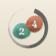 <b>Sum Stones</b></a></td>
    <td align="center" width="20%"><a href="https://play.google.com/store/apps/details?id=com.deltalo.honeyloop">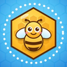 <b>Honey Loop</b></a></td>
    <td align="center" width="20%"><a href="https://play.google.com/store/apps/details?id=com.deltalo.bugrun"> <b>Bug Run</b></a></td>
    <td align="center" width="20%"><a href="https://play.google.com/store/apps/details?id=com.deltalo.bugfeast">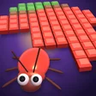 <b>Bug Feast</b></a></td>
    <td align="center" width="20%"><a href="https://play.google.com/store/apps/details?id=com.deltalo.coloratelier">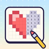 <b>Color Atelier</b></a></td>
  </tr>
  <tr>
    <td align="center" width="20%"><a href="https://play.google.com/store/apps/details?id=com.deltalo.doubletail">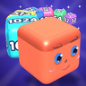 <b>Doubletail</b></a></td>
    <td align="center" width="20%"><a href="https://play.google.com/store/apps/details?id=com.deltalo.repcam"> <b>RepCam</b></a></td>
    <td align="center" width="20%"><a href="https://play.google.com/store/apps/details?id=com.deltalo.cubeline">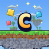 <b>Cubeline</b></a></td>
    <td align="center" width="20%"><a href="https://play.google.com/store/apps/details?id=com.deltalo.skyhop">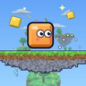 <b>Skyhop</b></a></td>
    <td align="center" width="20%"><a href="https://play.google.com/store/apps/details?id=com.deltalo.voxelpaint">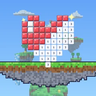 <b>Voxel Paint</b></a></td>
  </tr>
  <tr>
    <td align="center" width="20%"><a href="https://play.google.com/store/apps/details?id=com.deltalo.foxraid">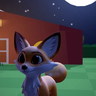 <b>Fox Raid</b></a></td>
    <td align="center" width="20%"><a href="https://play.google.com/store/apps/details?id=com.deltalo.teagarden">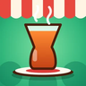 <b>Tea Garden</b></a></td>
    <td align="center" width="20%"><a href="https://play.google.com/store/apps/details?id=com.deltalo.fartrafters">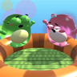 <b>Fart Rafters</b></a></td>
    <td align="center" width="20%"><a href="https://play.google.com/store/apps/details?id=com.deltalo.catarena">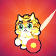 <b>Kedi Fight</b></a></td>
    <td align="center" width="20%"><a href="https://play.google.com/store/apps/details?id=com.deltalo.skyforge">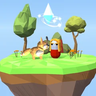 <b>Skyforge</b></a></td>
  </tr>
  <tr>
    <td align="center" width="20%"><a href="https://play.google.com/store/apps/details?id=com.deltalo.izlekazan"> <b>İzleKazan</b></a></td>
    <td align="center" width="20%"><a href="https://play.google.com/store/apps/details?id=com.deltalo.ibanmatik">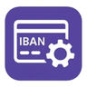 <b>IBAN Matik</b></a></td>
  </tr>
</table>

## 🛠️ What I work on

- **Game development** — Unity (C#) mobile games, gameplay systems, UI and store-ready release pipelines
- **Backend & multiplayer** — real-time game servers in Rust, APIs with Node.js / TypeScript, PostgreSQL and Redis
- **Cross-platform apps** — Flutter / Dart, including on-device computer vision (RepCam)
- **3D pipeline** — modeling, rigging and animation in Blender, automated into Unity
- **Automation & tooling** — Google Play Developer API releases, MCP servers for AI agents, browser extensions, Windows utilities
- **Earlier** — enterprise web platforms and CRM with C#, .NET Core, ASP.NET MVC, React and SQL

## ⭐ Featured open source

| Project | What it does |
|---|---|
| [mail-mcp](https://github.com/yusuf-polat/mail-mcp) | Security-focused MCP server that lets AI agents read and send email safely (zero-trust, attachment quarantine, DLP) |
| [hls-deck](https://github.com/yusuf-polat/hls-deck) | Desktop player and browser bridge for header-protected HLS (m3u8) streams |
| [epin](https://github.com/yusuf-polat/epin) | Open-source P2P e-pin & digital goods marketplace with escrow and seller stores |
| [Google-Trends](https://github.com/yusuf-polat/Google-Trends) | Real-time Google Trends MCP server for AI assistants |
| [guc-sayaci](https://github.com/yusuf-polat/guc-sayaci) | Ultra-light Windows tray app that tracks PC power usage and electricity cost |
| [kaldigim-yer](https://github.com/yusuf-polat/kaldigim-yer) | Chrome extension that remembers where you left off in series and movies |

## 🧰 Tech stack

  
  
  
  
  
  
  
  
  
  
  
  
  

---

Open to collaborations on games, developer tools and interesting engineering problems.

